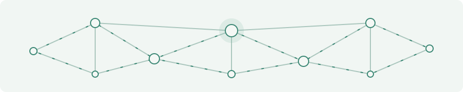

# Zhiheng Jin

**Control · Learning · Autonomous Systems**

I explore how models, data, and feedback can work together to make autonomous systems more capable and reliable.

## Research interests

- **System identification & control** — learning dynamics and designing model predictive controllers.
- **Robotics & motion planning** — connecting generative models with feasible robot motion.
- **Multi-agent systems** — coordination and decision-making under uncertainty.
- **Agent + Control** — exploring AI agents for control and automation.

## Notes & projects

- [Control Theory Slides](https://github.com/zjin73/Control-Theory-Slides) — teaching slides and reference materials.
- [Agent, Control & Grid](https://github.com/zjin73/Agent-Control-and-Grid) — a space for notes on agents, control, and energy systems.

[Website & research notes](https://zjin73.github.io/)
